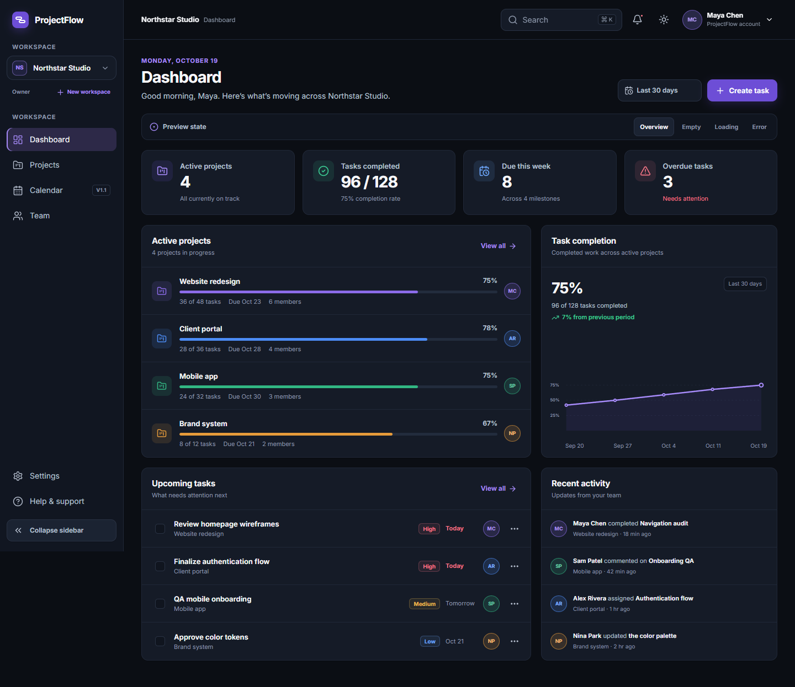
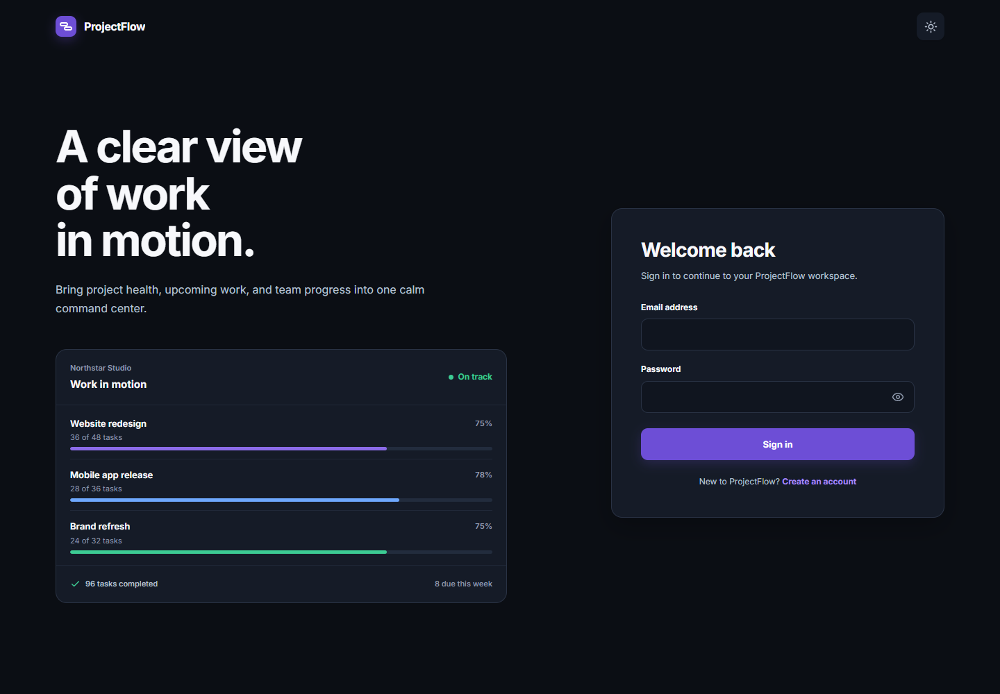
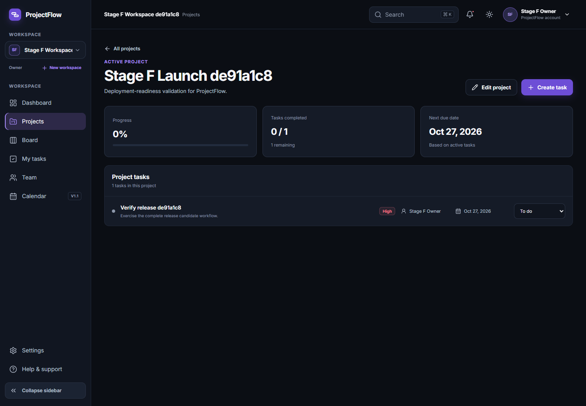
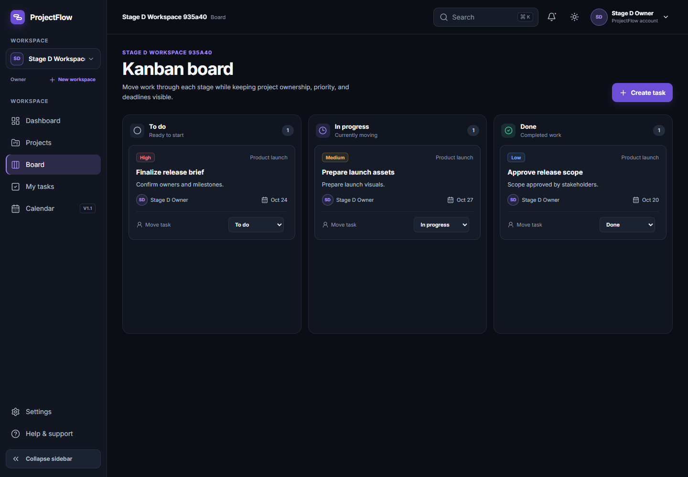
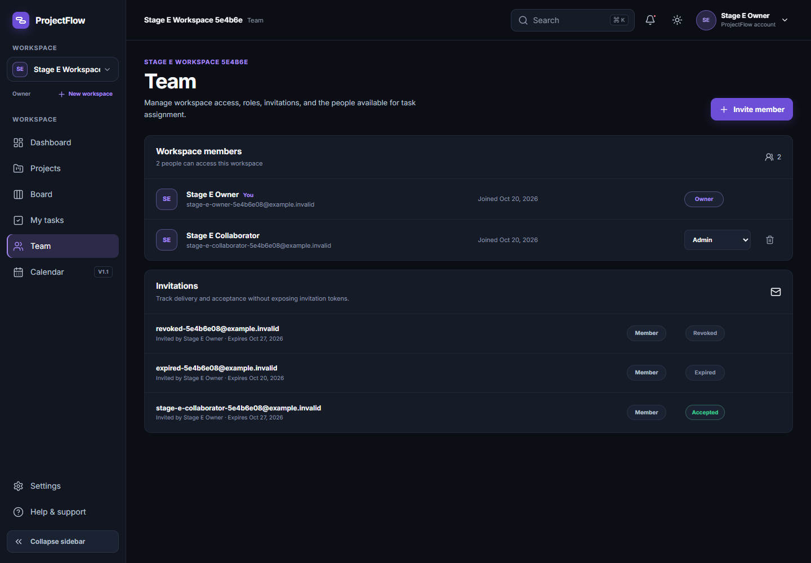
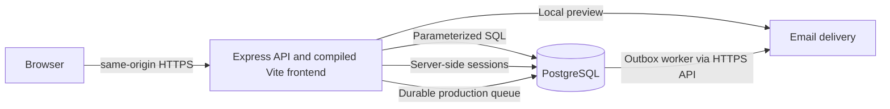

# ProjectFlow

ProjectFlow is a responsive, full-stack project management application for freelancers and small teams. It combines workspace isolation, projects, tasks, a keyboard-accessible Kanban workflow, invitations, comments, and activity history in a polished dark-first interface.

This repository is a portfolio application built from the approved **Modern Professional** design direction. A Render/Neon instance is live, and the secure portfolio demo plus premium landing page follow the controlled rollout documented in the deployment runbook. Portfolio demo mode remains disabled by default until migration, runtime grants, health, and isolation checks pass. Arbitrary-recipient email delivery remains constrained by Resend's test-sender restrictions until a sending domain is verified.



## Features

- Cookie-session authentication with registration, sign-in, restoration, protected routes, and logout
- Email verification and non-enumerating, single-use password recovery flows
- PostgreSQL-backed workspaces with owner, admin, and member permissions
- Project creation, editing, search, detail views, and archiving
- Task creation and editing with status, priority, due date, and workspace-member assignment
- Kanban board with drag-and-drop, keyboard/action-menu alternatives, persistence, undo, and failed-update recovery
- Workspace member management and secure email-addressed invitation lifecycle
- Task comments with author controls, moderator deletion, timestamps, and activity history
- Live dashboard metrics derived from the selected workspace's projects and tasks
- Dark and light themes with desktop, tablet, mobile, and 320 px layouts
- Loading, empty, error, permission, success, and session-expiration states

## Product views

All screenshots contain synthetic development data.

| Authentication | Project management |
| --- | --- |
|  |  |

| Kanban workflow | Team collaboration |
| --- | --- |
|  |  |

## Technology stack

| Area | Technology |
| --- | --- |
| Frontend | React 19, TypeScript, Vite, React Router, Tailwind CSS, Motion, Lucide React, Inter |
| Backend | Express 4, TypeScript, Node.js |
| Data | PostgreSQL, `node-postgres`, numbered raw SQL migrations |
| Authentication | Argon2id, `express-session`, PostgreSQL session store, HttpOnly cookies |
| Validation and security | Zod, Helmet, strict write-origin checks, bounded JSON requests, rate limiting |
| Collaboration | Encrypted PostgreSQL email outbox, local preview, optional SMTP, and Resend HTTPS API delivery |
| Quality | Vitest, Testing Library, Supertest, Playwright, axe-core |

The backend uses SQL directly through `node-postgres`. Prisma is not installed or used.

## Architecture



The frontend keeps authentication and the selected workspace in shared React state. Every protected API operation is authorized again on the server. Workspace membership joins scope projects, tasks, comments, invitations, and activity records; inaccessible cross-workspace resources return `404` without disclosing their existence.

```text
projectflow/
├── src/                         React application and tests
├── public/                      Static frontend assets
├── backend/
│   ├── sql/                     Ordered raw SQL migrations
│   └── src/                     Express API, services, validation, and tests
├── docs/images/                 Curated portfolio screenshots
├── scripts/                     Browser and PostgreSQL QA workflows
├── STAGE-*-CHECKPOINT.md         Verified development checkpoints
├── FULLSTACK-SETUP.md            Local full-stack notes
└── package.json                  Frontend scripts and dependencies
```

## Requirements

- Node.js 24 LTS
- npm
- PostgreSQL running locally or an accessible PostgreSQL instance

## Environment configuration

Only placeholder templates are committed. Copy them before local development:

```powershell
Copy-Item .env.example .env
Copy-Item backend\.env.example backend\.env
```

Frontend:

```dotenv
VITE_API_URL=http://localhost:4000
```

Backend variables include `DATABASE_URL`, `SESSION_SECRET`, `FRONTEND_ORIGIN`, token lifetimes, proxy trust, verification policy, logging, Resend API configuration, `EMAIL_OUTBOX_KEY`, and the disabled-by-default `DEMO_MODE_ENABLED` switch. Generate unique session and 32-byte base64 outbox-encryption keys and keep both `.env` files local. Production requires an exact HTTPS origin, a TLS PostgreSQL URL containing `sslmode=require` or stronger, verified email delivery, and email verification. Production migrations use a separate operator-only `MIGRATION_DATABASE_URL` so the normal application can retain Neon's pooled `DATABASE_URL`. See [backend/.env.example](./backend/.env.example) for the complete safe template.

## PostgreSQL setup on Windows

Open `psql` with the administrator role created by the PostgreSQL installer. Adjust `18` if another version is installed:

```powershell
& 'C:\Program Files\PostgreSQL\18\bin\psql.exe' -h localhost -p 5432 -U postgres -d postgres
```

Create a dedicated local role and database:

```sql
CREATE ROLE projectflow LOGIN PASSWORD 'choose-a-unique-local-password';
CREATE DATABASE projectflow OWNER projectflow;
\q
```

Set the corresponding local `DATABASE_URL` in `backend/.env`, then run the numbered migrations:

```powershell
Set-Location backend
npm.cmd install
npm.cmd run db:migrate
```

The migration runner applies each pending migration in `backend/sql` in order. It serializes concurrent runs with a PostgreSQL advisory lock, wraps each file in a transaction, and records SHA-256 checksums in `schema_migrations`. Applied migration files must never be edited. It does not use Prisma.

## Portfolio demo mode

ProjectFlow has an auth-aware public root route. An unauthenticated visitor to `/` sees the public product landing page; a restored authenticated session at `/` continues directly to the existing dashboard. Protected deep links retain their sign-in redirects, and session restoration completes before either root experience renders. The landing page uses responsive captures generated from the real locally seeded dashboard and Kanban UI, with no fabricated product claims or statistics.

Portfolio demo mode is an explicit, production-safe opt-in. With migration `006_portfolio_demo.sql` applied and `DEMO_MODE_ENABLED=true`, **Try Live Demo** on the landing page (or **Try Demo** on sign-in) creates a private, writable workspace for one browser session. Each instance receives a disabled-login demo identity, two synthetic teammates, three projects, twelve tasks, comments, and activity. Normal registration, email verification, password recovery, and real workspaces are unchanged.

Demo instances expire after 30 minutes. Expired data is removed on the next demo creation or expired-session request, and logout removes the current instance immediately, so no paid background worker is required. Creation is limited to five attempts per IP per hour and 25 active instances; each instance is capped at five projects, 40 tasks, 50 comments, and 200 activity entries. Demo users cannot create workspaces, deliver invitations, accept invitations, manage membership, change account credentials, or authenticate with the generated `.invalid` email address.

Keep `DEMO_MODE_ENABLED=false` until migration 006 has been applied through the direct migration connection and the pooled runtime role has been verified against `demo_instances`. The local browser harness uses only a loopback PostgreSQL URL and an isolated disposable schema:

```powershell
npm.cmd run build:all
$env:PROJECTFLOW_LOCAL_ENV_PATH = '<private path to a local backend .env>'
npm.cmd --prefix backend run verify:demo:browser
npm.cmd --prefix backend run verify:landing:browser
```

The reproducible preview-capture command uses the same loopback-only disposable-schema safeguards and cleans up its temporary demo before exiting:

```powershell
$env:PROJECTFLOW_LOCAL_ENV_PATH = '<private path to a local backend .env>'
npm.cmd --prefix backend run verify:capture:landing
```

## Installation and local development

Install the frontend and backend independently:

```powershell
# From the repository root
npm.cmd install

# Then install backend dependencies
Set-Location backend
npm.cmd install
```

Start the API in one terminal:

```powershell
Set-Location backend
npm.cmd run dev
```

Start the frontend in a second terminal:

```powershell
npm.cmd run dev -- --host localhost --port 5173
```

- Frontend: `http://localhost:5173`
- API: `http://localhost:4000`
- Health check: `http://localhost:4000/api/health`

`FRONTEND_ORIGIN` must exactly match the browser origin. Authenticated frontend requests use `credentials: 'include'` so the HttpOnly session cookie is sent.

## Testing and builds

Run the checks from the repository root:

```powershell
# Frontend
npm.cmd test
npm.cmd run typecheck
npm.cmd run build:frontend
npm.cmd audit

# Complete production builds
npm.cmd run build:all

# Backend
Set-Location backend
npm.cmd test
npm.cmd run typecheck
npm.cmd run build
npm.cmd audit
```

With PostgreSQL, the API, and frontend running, these workflows exercise real persistence and browser behavior using isolated temporary records:

```powershell
npm.cmd run project-task:qa
npm.cmd run kanban:qa
npm.cmd run collaboration:qa
npm.cmd run stage-f:qa
```

The QA scripts remove only records they create. Generated screenshots, reports, local databases, dependencies, builds, logs, tool caches, and real environment files are excluded from source control.

## Authentication and security

- Passwords are validated at 12–128 characters and stored as Argon2id hashes.
- Sessions are stored server-side in PostgreSQL and regenerated after authentication.
- Password resets increment a session version so previously issued sessions stop authorizing requests.
- Development cookies are HttpOnly and SameSite=Lax; production configuration requires HTTPS and uses a Secure `__Host-` cookie.
- State-changing requests require the configured `Origin`.
- JSON requests are limited to 64 KB and validated with Zod.
- Login and registration endpoints are rate-limited.
- Invitation tokens are high entropy, expiring, revocable, single-use, absent from list APIs, and stored only as SHA-256 hashes.
- Verification and reset tokens are high entropy, expiring, single-use, and stored only as SHA-256 hashes. Reset requests return the same response for known and unknown email addresses.
- Production invitation, verification, and reset messages enter an encrypted PostgreSQL outbox before Resend HTTPS delivery. Stable idempotency keys protect retries from duplicate sends, successful jobs are deleted so bearer links are not retained, and reset requests use a minimum response window to reduce account-enumeration timing differences.
- PostgreSQL operations use parameterized SQL and server-side membership checks.

The [Stage F QA and security checkpoint](./STAGE-F-QA-SECURITY-CHECKPOINT.md) records the verified findings, fixes, open risks, and deployment gates.

## Current status

Completed and locally verified:

- Stage A — frontend authentication integration
- Stage B — workspace integration
- Stage C — projects and tasks
- Stage D — Kanban workflow management
- Stage E — team collaboration
- Stage F — application QA and security hardening
- Stage G1 — deployment planning and readiness assessment
- Stage G2 — local production-readiness implementation
- Stage G3A — Free-tier deployment compatibility
- Stage G3B — Neon initialization and least-privilege runtime role
- Stage G3C — local Render Free deployment readiness
- Secure portfolio demo — private writable 30-minute sessions with bounded cleanup
- Premium public landing page — auth-aware root routing and responsive real-product previews

## Deployment readiness

The approved target is one Render Free web service serving both Express `/api` routes and the compiled Vite application, with Neon Free PostgreSQL and the Resend Free HTTPS API. The committed `render.yaml` contains no credentials and deploys only after the required GitHub checks pass. GitHub Actions runs on Node.js 24 LTS and covers frontend/backend tests, three backend timezone variants, typechecks, full Render artifact builds, high-severity dependency audits, a real PostgreSQL concurrent-migration check, and an isolated `pg_dump`/`pg_restore` recovery rehearsal with a failed-migration rollback probe.

Read [the deployment runbook](./docs/DEPLOYMENT-RUNBOOK.md) and [database recovery procedure](./docs/DATABASE-RECOVERY.md) before changing hosted resources. Production changes require explicit operator approval and must preserve the documented migration, health, rollback, and demo-activation gates.

## Known limitations and deployment blockers

- Portfolio demo mode is disabled by default and must not be enabled until migration 006, least-privilege runtime grants, deployment health, and live isolation checks pass.
- Resend HTTPS API delivery is implemented, but live provider delivery, sender DNS, bounce handling, and account recovery email receipt have not been verified.
- Rate limits use process memory and require a shared store for multiple API instances.
- Local production configuration, CSP/HSTS, proxy assumptions, TLS database validation, migration safety, and structured redacted logs are implemented; their behavior through Render and Neon remains a hosted verification gate.
- The current `pg` stack treats Neon's `sslmode=require` as host-verifying TLS, but its next major version plans to align with libpq semantics. Review and prefer `sslmode=verify-full` before that dependency upgrade.
- Workspace ownership transfer, distributed throttling, production backup scheduling/storage, hosted Neon restore rehearsal, and external security testing remain outstanding. The equivalent local and CI logical restore path is automated and verified.
- Real-time updates, advanced search, notifications, calendar views, advanced analytics, and customizable workflows are outside the current release.

## Roadmap

1. Review the Stage G2 checkpoint and approve or revise the hosted deployment profile.
2. Provision and verify Render, Neon, Resend, monitoring, and backup procedures only after explicit approval.
3. Add notifications, advanced search and filters, calendar, and advanced task views.
4. Explore file attachments, advanced analytics, customizable Kanban workflows, and external integrations.

## Project documentation

- [Full-stack local setup](./FULLSTACK-SETUP.md)
- [Stage A authentication checkpoint](./STAGE-A-AUTH-CHECKPOINT.md)
- [Stage B workspace checkpoint](./STAGE-B-WORKSPACE-CHECKPOINT.md)
- [Stage C projects and tasks checkpoint](./STAGE-C-PROJECTS-TASKS-CHECKPOINT.md)
- [Stage D Kanban checkpoint](./STAGE-D-KANBAN-CHECKPOINT.md)
- [Stage E collaboration checkpoint](./STAGE-E-COLLABORATION-CHECKPOINT.md)
- [Stage F QA and security checkpoint](./STAGE-F-QA-SECURITY-CHECKPOINT.md)
- [Stage G1 deployment plan](./STAGE-G1-DEPLOYMENT-PLAN.md)
- [Stage G2 readiness checkpoint](./STAGE-G2-READINESS-CHECKPOINT.md)
- [Deployment runbook](./docs/DEPLOYMENT-RUNBOOK.md)
- [Database recovery procedure](./docs/DATABASE-RECOVERY.md)
- [Portfolio demo checkpoint](./PORTFOLIO-DEMO-CHECKPOINT.md)
- [Landing page checkpoint](./LANDING-PAGE-CHECKPOINT.md)
- [Backend setup and API reference](./backend/README.md)
