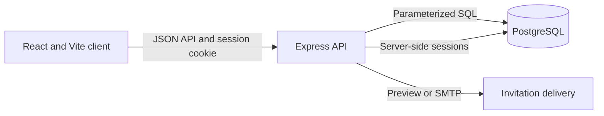

# ProjectFlow

ProjectFlow is a responsive, full-stack project management application for freelancers and small teams. It combines workspace isolation, projects, tasks, a keyboard-accessible Kanban workflow, invitations, comments, and activity history in a polished dark-first interface.

This repository is a portfolio application built from the approved **Modern Professional** design direction. Stages A–F are implemented and verified locally. The application is not deployed or represented as production-ready.


## Features

- Cookie-session authentication with registration, sign-in, restoration, protected routes, and logout
- PostgreSQL-backed workspaces with owner, admin, and member permissions
- Project creation, editing, search, detail views, and archiving
- Task creation and editing with status, priority, due date, and workspace-member assignment
- Kanban board with drag-and-drop, keyboard/action-menu alternatives, persistence, undo, and failed-update recovery
- Workspace member management and secure email-addressed invitation lifecycle
- Task comments with author controls, moderator deletion, timestamps, and activity history
- Live dashboard metrics derived from the selected workspace's projects and tasks
- Dark and light themes with desktop, tablet, mobile, and 320 px layouts
- Loading, empty, error, permission, success, and session-expiration states

## Product views

All screenshots contain synthetic development data.

| Authentication | Project management |
| --- | --- |
|  |  |

| Kanban workflow | Team collaboration |
| --- | --- |
|  |  |

## Technology stack

| Area | Technology |
| --- | --- |
| Frontend | React 19, TypeScript, Vite, React Router, Tailwind CSS, Motion, Lucide React, Inter |
| Backend | Express 4, TypeScript, Node.js |
| Data | PostgreSQL, `node-postgres`, numbered raw SQL migrations |
| Authentication | Argon2id, `express-session`, PostgreSQL session store, HttpOnly cookies |
| Validation and security | Zod, Helmet, strict write-origin checks, bounded JSON requests, rate limiting |
| Collaboration | Nodemailer with local preview mode or configurable SMTP delivery |
| Quality | Vitest, Testing Library, Supertest, Playwright, axe-core |

The backend uses SQL directly through `node-postgres`. Prisma is not installed or used.

## Architecture



The frontend keeps authentication and the selected workspace in shared React state. Every protected API operation is authorized again on the server. Workspace membership joins scope projects, tasks, comments, invitations, and activity records; inaccessible cross-workspace resources return `404` without disclosing their existence.

```text
projectflow/
├── src/                         React application and tests
├── public/                      Static frontend assets
├── backend/
│   ├── sql/                     Ordered raw SQL migrations
│   └── src/                     Express API, services, validation, and tests
├── docs/images/                 Curated portfolio screenshots
├── scripts/                     Browser and PostgreSQL QA workflows
├── STAGE-*-CHECKPOINT.md         Verified development checkpoints
├── FULLSTACK-SETUP.md            Local full-stack notes
└── package.json                  Frontend scripts and dependencies
```

## Requirements

- Node.js 20 or newer
- npm
- PostgreSQL running locally or an accessible PostgreSQL instance

## Environment configuration

Only placeholder templates are committed. Copy them before local development:

```powershell
Copy-Item .env.example .env
Copy-Item backend\.env.example backend\.env
```

Frontend:

```dotenv
VITE_API_URL=http://localhost:4000
```

Backend variables include `DATABASE_URL`, `SESSION_SECRET`, `FRONTEND_ORIGIN`, invitation delivery settings, and optional SMTP credentials. Generate a unique session secret of at least 32 characters and keep both `.env` files local. See [backend/.env.example](./backend/.env.example) for the complete safe template.

## PostgreSQL setup on Windows

Open `psql` with the administrator role created by the PostgreSQL installer. Adjust `18` if another version is installed:

```powershell
& 'C:\Program Files\PostgreSQL\18\bin\psql.exe' -h localhost -p 5432 -U postgres -d postgres
```

Create a dedicated local role and database:

```sql
CREATE ROLE projectflow LOGIN PASSWORD 'choose-a-unique-local-password';
CREATE DATABASE projectflow OWNER projectflow;
\q
```

Set the corresponding local `DATABASE_URL` in `backend/.env`, then run the numbered migrations:

```powershell
Set-Location backend
npm.cmd install
npm.cmd run db:migrate
```

The migration runner applies each migration in `backend/sql` in order. It does not use Prisma.

## Installation and local development

Install the frontend and backend independently:

```powershell
# From the repository root
npm.cmd install

# Then install backend dependencies
Set-Location backend
npm.cmd install
```

Start the API in one terminal:

```powershell
Set-Location backend
npm.cmd run dev
```

Start the frontend in a second terminal:

```powershell
npm.cmd run dev -- --host localhost --port 5173
```

- Frontend: `http://localhost:5173`
- API: `http://localhost:4000`
- Health check: `http://localhost:4000/api/health`

`FRONTEND_ORIGIN` must exactly match the browser origin. Authenticated frontend requests use `credentials: 'include'` so the HttpOnly session cookie is sent.

## Testing and builds

Run the checks from the repository root:

```powershell
# Frontend
npm.cmd test
npm.cmd run typecheck
npm.cmd run build
npm.cmd audit

# Backend
Set-Location backend
npm.cmd test
npm.cmd run typecheck
npm.cmd run build
npm.cmd audit
```

With PostgreSQL, the API, and frontend running, these workflows exercise real persistence and browser behavior using isolated temporary records:

```powershell
npm.cmd run project-task:qa
npm.cmd run kanban:qa
npm.cmd run collaboration:qa
npm.cmd run stage-f:qa
```

The QA scripts remove only records they create. Generated screenshots, reports, local databases, dependencies, builds, logs, tool caches, and real environment files are excluded from source control.

## Authentication and security

- Passwords are validated at 12–128 characters and stored as Argon2id hashes.
- Sessions are stored server-side in PostgreSQL and regenerated after authentication.
- Development cookies are HttpOnly and SameSite=Lax; production configuration requires HTTPS and uses a Secure `__Host-` cookie.
- State-changing requests require the configured `Origin`.
- JSON requests are limited to 64 KB and validated with Zod.
- Login and registration endpoints are rate-limited.
- Invitation tokens are high entropy, expiring, revocable, single-use, absent from list APIs, and stored only as SHA-256 hashes.
- PostgreSQL operations use parameterized SQL and server-side membership checks.

The [Stage F QA and security checkpoint](./STAGE-F-QA-SECURITY-CHECKPOINT.md) records the verified findings, fixes, open risks, and deployment gates.

## Current status

Completed and locally verified:

- Stage A — frontend authentication integration
- Stage B — workspace integration
- Stage C — projects and tasks
- Stage D — Kanban workflow management
- Stage E — team collaboration
- Stage F — application QA and security hardening

## Known limitations and deployment blockers

- No public deployment or production environment has been verified.
- SMTP transport is implemented, but live provider delivery has not been verified.
- Rate limits use process memory and require a shared store for multiple API instances.
- Production still needs TLS and proxy validation, frontend security headers including a tested CSP, managed secrets, encrypted remote database transport, backups, monitoring, and structured redacted logs.
- Email verification, password recovery, workspace ownership transfer, and external security testing remain outstanding.
- Real-time updates, advanced search, notifications, calendar views, advanced analytics, and customizable workflows are outside the current release.

## Roadmap

1. Resolve the Stage F deployment blockers in an environment-specific plan.
2. Add email verification and password recovery.
3. Add notifications, advanced search and filters, calendar, and advanced task views.
4. Explore file attachments, advanced analytics, customizable Kanban workflows, and external integrations.

## Project documentation

- [Full-stack local setup](./FULLSTACK-SETUP.md)
- [Stage A authentication checkpoint](./STAGE-A-AUTH-CHECKPOINT.md)
- [Stage B workspace checkpoint](./STAGE-B-WORKSPACE-CHECKPOINT.md)
- [Stage C projects and tasks checkpoint](./STAGE-C-PROJECTS-TASKS-CHECKPOINT.md)
- [Stage D Kanban checkpoint](./STAGE-D-KANBAN-CHECKPOINT.md)
- [Stage E collaboration checkpoint](./STAGE-E-COLLABORATION-CHECKPOINT.md)
- [Stage F QA and security checkpoint](./STAGE-F-QA-SECURITY-CHECKPOINT.md)
- [Backend setup and API reference](./backend/README.md)
