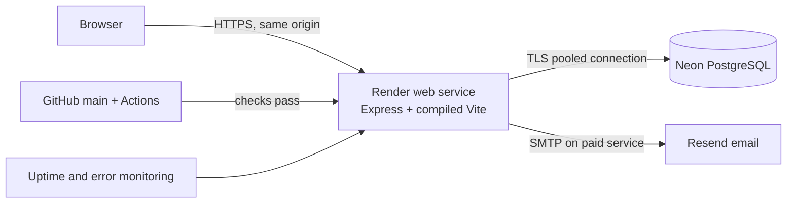

# ProjectFlow Stage G1 — Production Deployment Planning and Readiness Assessment

> **Superseded deployment profile:** Stage G3A selects the zero-cost Render Free + Neon Free + Resend HTTPS API profile described in this plan. See `STAGE-G3A-DEPLOYMENT-PREFLIGHT.md` and `docs/DEPLOYMENT-RUNBOOK.md` for the current configuration. Historical paid/SMTP recommendations below are retained as planning history.

**Status:** Planning complete; deployment not started

**Prepared:** 2026-10-22

**Repository:** [github.com/Yukiiii2/projectflow](https://github.com/Yukiiii2/projectflow)

**Branch inspected:** `main`

**Stage F baseline:** `e75b322` (`docs: record Stage F resume verification`)

## Scope and decision

This document plans a production-like portfolio deployment of the existing React/Vite frontend, Express API, and PostgreSQL data layer. It does not authorize creating cloud resources, purchasing a domain, changing DNS, or deploying the application.

The recommended architecture is a **single Render web service that serves both the compiled Vite application and the Express `/api` routes**, connected to a managed Neon PostgreSQL database. Resend is the preferred transactional email provider. GitHub Actions should validate every change before Render deploys `main`.

This keeps the browser and API on one HTTPS origin. That choice fits the existing `Secure`, `HttpOnly`, `SameSite=Lax`, `__Host-` session cookie and exact-Origin CSRF check without weakening cookies to `SameSite=None`. It also removes production CORS complexity and avoids dependence on third-party cookie behavior. MDN confirms that `SameSite=Lax` cookies are not sent by cross-site `fetch` requests even when `credentials: "include"` is used ([cookie guidance](https://developer.mozilla.org/en-US/docs/Web/HTTP/Guides/Cookies), [Fetch credentials guidance](https://developer.mozilla.org/en-US/docs/Web/API/Fetch_API/Using_Fetch)).



## Current application assessment

### Verified foundation

- The public GitHub repository exists at `https://github.com/Yukiiii2/projectflow.git`; `main` was clean and synchronized with `origin/main` during this assessment.
- Stage F records 32 passing frontend tests, 15 passing backend tests, three timezone regression runs, clean frontend/backend builds and audits, a real PostgreSQL/browser workflow, and zero temporary QA accounts remaining.
- Authentication uses Argon2id password hashes, server-side PostgreSQL sessions, session regeneration, bounded validation, exact-Origin write checks, production Secure cookies, and generic server errors.
- Workspace, project, task, Kanban, invitation, membership, comment, and activity operations are authorized on the server and were tested for cross-workspace isolation.
- `GET /api/health` executes `SELECT 1`, so it is suitable as an application and database readiness check.
- The repository contains numbered raw SQL migrations and safe placeholder environment templates. Real `.env` files are ignored.

### Readiness gaps found in the current code

These are deployment tasks, not reasons to redesign or migrate the application:

1. The Express server does not yet serve the Vite `dist` directory or provide an SPA fallback. The current production build therefore needs two hosts unless a small static-serving change is made.
2. `src/auth/api.ts` defaults to `http://localhost:4000` when `VITE_API_URL` is absent. A same-origin production build must default to an empty base URL while retaining the localhost default in development.
3. The SQL migration runner reapplies every SQL file and has no migration ledger, advisory lock, checksum, or per-migration transaction. The two current migrations are largely idempotent, but this is not safe enough for unattended future production migrations.
4. `pg.Pool` receives only `DATABASE_URL`. The production connection string must explicitly require TLS and use the provider's pooled endpoint.
5. Production invitation delivery is SMTP-only. Render's free web services block outbound SMTP ports 25, 465, and 587, so SMTP requires a paid Render instance or a small HTTPS email-provider adapter ([Render free-service limits](https://render.com/docs/free)).
6. Login and registration rate limits use process memory. This is acceptable only for a single low-traffic instance with the reset-on-restart limitation documented. A shared store is required before horizontal scaling and preferred before opening registration broadly.
7. The API uses generic `console.error` logging. It needs structured, centrally collected logs with redaction before processing real user data.
8. Email verification and password recovery are not implemented. An unrestricted public signup launch should wait for both.
9. The production browser response policy still needs a tested CSP, HSTS, asset caching rules, and an environment-level proxy/TLS verification.
10. Backup restoration, migration rollback, live email delivery, production HTTPS sessions, and monitoring alerts have not been rehearsed in a hosted environment.

## Hosting evaluation

### Frontend

**Recommended:** compile Vite during the Render build and serve `dist` from Express.

Benefits:

- one HTTPS origin for the UI, API, and session cookie;
- no production CORS dependency;
- no cross-site cookie exception;
- one service, health check, deploy, and custom domain;
- Helmet can protect both HTML/assets and API responses.

The server should return `index.html` only for non-API navigation routes. Unknown `/api/*` requests must keep the current JSON 404 behavior. Hashed assets should use long-lived immutable caching; `index.html` should use `no-cache` so new releases load promptly.

**Alternative:** Cloudflare Pages or Render Static Sites for the frontend and Render for the API. Both offer free static hosting, and Cloudflare Pages currently lists 500 builds per month on its Free plan ([Cloudflare Pages limits](https://developers.cloudflare.com/pages/platform/limits/)). This split is appropriate only after assigning related custom-domain origins such as `app.example.com` and `api.example.com`, retesting CORS/CSRF/cookies, and accepting the added operational complexity. Unrelated default provider domains should not be used for cookie authentication.

Vercel Hobby is also technically suitable for static Vite output, but its terms restrict Hobby to personal/non-commercial use. The same split-origin cookie concern remains ([Vercel terms](https://vercel.com/legal/terms)).

### Backend

**Recommended:** Render Web Service, one instance, Node.js 20 or newer.

- Stable portfolio baseline: Render Starter at **$7/month** for 0.5 CPU and 512 MB RAM ([Render pricing](https://render.com/pricing), [compute plans](https://render.com/docs/compute-plans)).
- Budget pilot: Render Free at **$0/month**, with cold starts after 15 idle minutes and up to 750 free instance-hours per workspace. It is useful for a recruiter demo but less polished because wake-up can take about a minute and SMTP ports are blocked ([Render free-service limits](https://render.com/docs/free)).
- Configure `/api/health` as the HTTP health-check path. Render uses health checks to prevent unhealthy releases from receiving traffic and to restart unhealthy instances ([Render health checks](https://render.com/docs/health-checks)).
- Keep one instance initially. Add a shared rate-limit store and review session connection capacity before scaling beyond one.

Render provides managed TLS for its `onrender.com` domain and custom domains, automatically renews certificates, and redirects HTTP to HTTPS ([Render TLS](https://render.com/docs/tls)). The application should still emit HSTS after the HTTPS topology has been verified.

### Managed PostgreSQL

**Recommended:** Neon PostgreSQL in the same or nearest available region to Render.

- The current Neon Free plan is sufficient for a portfolio workload: **$0/month**, 1 GB storage per project, 100 CU-hours per project/month, and a six-hour restore window ([Neon Free plan update](https://neon.com/blog/neon-free-plan-1-gb-per-project)).
- Use Neon's **pooled** connection string with `sslmode=require`. Neon recommends pooling for applications with multiple connections, and its connection strings support enforced TLS ([Neon performance guidance](https://neon.com/blog/performance-tips-for-neon-postgres), [connection example](https://neon.com/blog/build-and-deploy-global-serverless-nuxt-ssr-app-with-cloudflare-hyperdrive-and-postgres)).
- Do not use Render Free PostgreSQL for this application: free Render databases expire after 30 days and do not provide backups ([Render free-service limits](https://render.com/docs/free)).
- For a public application with data that cannot be recreated, use a paid Neon plan and define a longer point-in-time restore window. Neon paid usage is workload-based; current pricing should be confirmed immediately before purchase. Neon supports point-in-time restore up to a configured retention limit and still recommends occasional logical exports where appropriate ([Neon restore overview](https://neon.com/blog/announcing-point-in-time-restore)).

### Email delivery and account recovery

**Recommended:** Resend with an authenticated sending domain.

- Resend Free currently provides 3,000 emails/month and 100/day at **$0/month**, which is enough for a portfolio application ([Resend pricing](https://resend.com/pricing)).
- On Render Starter, retain the existing Nodemailer SMTP architecture and configure Resend's SMTP relay through managed secrets. Verify outbound SMTP from the selected service during provisioning; use the HTTPS adapter if the service or provider still rejects the connection.
- On Render Free, add a narrow Resend HTTPS API delivery adapter because outbound SMTP is blocked. This is a contained provider integration, not an application rewrite.
- Verify the sender domain, SPF, DKIM, invitation delivery, bounce behavior, and provider event visibility. Domain/DNS changes require explicit owner approval and are outside Stage G1.
- Add email verification and password-reset flows before enabling unrestricted public registration. Reset tokens should be random, stored only as hashes, short-lived, single-use, and invalidated after use; responses must not reveal whether an email address exists. Password reset should rotate active sessions.
- Until those flows exist, launch as an approval-only portfolio demo or add and set `PUBLIC_REGISTRATION_ENABLED=false`, then provision a synthetic reviewer account through an administrative runbook.

## Estimated operating cost

Prices are estimates checked on 2026-10-22 and should be reconfirmed before purchase.

| Profile | Render | Neon | Email | CI/monitoring | Domain | Estimated total |
| --- | ---: | ---: | ---: | ---: | ---: | ---: |
| Budget pilot | Free web service | Free | Free HTTPS email API | GitHub Actions + free monitoring | Provider URL | **$0/month** |
| Recommended portfolio | Starter web service | Free | Resend Free SMTP | GitHub Actions + free monitoring | Optional, typically $10–20/year | **$7/month**, plus domain |
| Data-retentive public pilot | Starter web service | Paid Neon usage, budget from about $5/month | Resend Free | GitHub Actions + free/low-cost monitoring | Optional domain | **About $12+/month**, plus domain and usage |
| Higher email volume | Starter web service | Paid or Free as appropriate | Resend Pro, currently $20/month | As above | Optional domain | **About $27+/month**, plus database/domain |

GitHub Actions standard hosted runners are free for public repositories ([GitHub Actions billing](https://docs.github.com/en/billing/concepts/product-billing/github-actions?apiVersion=2022-11-28)). Neon's current paid usage model has a $5 minimum according to its November 2025 pricing update, but actual database cost depends on compute and storage ([Neon pricing update](https://neon.com/blog/major-compute-price-reduction-on-neon)). Free monitoring tiers vary and should be checked when selected; do not make availability guarantees based only on this estimate.

## Required configuration changes before deployment

### 1. Same-origin production serving

Make the smallest architecture-preserving changes:

- Update the frontend API base to use `""` in production and `http://localhost:4000` in development unless `VITE_API_URL` is explicitly set.
- Build the frontend into root `dist/`.
- In production, serve root `dist/` from Express after security/session middleware.
- Keep all `/api` routes ahead of the SPA fallback.
- Return `index.html` for valid client-side routes only; retain JSON 404 for `/api/*`.
- Add a production integration test that loads a deep link, signs in, refreshes, and verifies the same Secure session.

Expected Render commands after those code changes:

```text
Build: npm ci && npm run build && npm --prefix backend ci && npm --prefix backend run build
Start: npm --prefix backend start
Health check: /api/health
```

Do not set a fixed `PORT`; Render supplies it. The existing server already reads `process.env.PORT`.

### 2. Production response policy

Configure and test:

- a nonce-free CSP compatible with the compiled Vite bundle, local Inter font files, icons, and API calls;
- `Strict-Transport-Security` after HTTPS is confirmed, preferably with a conservative initial max-age before considering `includeSubDomains` or preload;
- `X-Content-Type-Options: nosniff`, frame blocking, and the current no-referrer policy;
- `Cache-Control: no-cache` for `index.html` and `public, max-age=31536000, immutable` for hashed assets;
- compression at the platform or application layer;
- no stack traces, secrets, cookies, tokens, connection strings, or invitation URLs in responses or logs.

Helmet already supplies part of this policy. Extend and test the existing middleware rather than adding a competing header layer.

### 3. Environment variables and secrets

Store production values only in Render's managed environment. Never prefix backend secrets with `VITE_`, because Vite embeds such values into browser assets.

| Variable | Classification | Production guidance |
| --- | --- | --- |
| `NODE_ENV` | Configuration | `production` |
| `PORT` | Platform | Let Render provide it |
| `DATABASE_URL` | Secret | Neon pooled URL with TLS required; rotate after accidental exposure |
| `SESSION_SECRET` | Secret | At least 32 random bytes; preferably 64; generated independently of all other keys |
| `FRONTEND_ORIGIN` | Public configuration | Exact final HTTPS origin, with no trailing slash |
| `INVITATION_TTL_HOURS` | Configuration | Keep 168 unless product policy changes |
| `INVITATION_DELIVERY` | Configuration | `smtp` on the recommended paid service |
| `SMTP_HOST`, `SMTP_PORT` | Configuration | Provider values |
| `SMTP_USER`, `SMTP_PASSWORD` | Secret | Managed provider credential; least privilege and rotatable |
| `INVITATION_FROM` | Public configuration | Verified sender identity |
| `VITE_API_URL` | Public build value | Omit for same-origin production after fallback fix |
| Monitoring DSN | Restricted configuration | Client DSN may be public by design; server auth tokens remain secret |

Generate the session secret locally without printing or committing it, for example:

```powershell
$bytes = [byte[]]::new(48)
[Security.Cryptography.RandomNumberGenerator]::Fill($bytes)
[Convert]::ToBase64String($bytes) | Set-Clipboard
Remove-Variable bytes
```

Paste it directly from the clipboard into the host's secret field. Rotate it deliberately; rotation logs out every active session.

### 4. Sessions, CORS, CSRF, and proxy behavior

- Keep the production cookie name `__Host-projectflow.sid`, `Secure`, `HttpOnly`, `Path=/`, no `Domain`, and `SameSite=Lax`.
- Keep exact-Origin checks for every state-changing request. With same-origin serving, set `FRONTEND_ORIGIN` to the Render or custom-domain HTTPS origin.
- Retain `credentials: "include"` in the frontend client.
- Verify Render's proxy chain using an integration test before trusting `req.ip` for throttling. The current `trust proxy = 1` must match the actual topology and direct access to the process must not be possible.
- Add Fetch Metadata (`Sec-Fetch-Site`) rejection for cross-site state-changing requests as defense in depth after confirming browser compatibility. Do not use it as the sole CSRF control.
- If frontend and API are ever split, use same-site custom subdomains and retest the complete threat model. Do not solve unrelated provider domains by switching to `SameSite=None` as the default architecture.

### 5. Rate limiting

For the initial single-instance reviewer deployment:

- retain the current 10 failed logins per 15 minutes and 20 registrations per hour;
- verify `req.ip` through the real proxy;
- monitor 429 responses;
- document that counters reset when the instance restarts.

Before multiple API instances or unrestricted public registration:

- replace the memory store with a managed Redis-compatible store;
- namespace keys by environment and route;
- configure connection timeouts and fail behavior;
- test that two API instances share the same counters;
- add per-account and password-reset throttles in addition to IP limits.

### 6. Migration safety

Before the first hosted migration, update the runner to:

1. acquire a PostgreSQL advisory lock;
2. create a `schema_migrations` table if absent;
3. record migration filename, checksum, and applied timestamp;
4. apply each pending migration in its own transaction;
5. fail when an applied file's checksum changes;
6. release the lock in `finally`;
7. avoid automatic destructive down migrations.

Deployment sequence for every schema change:

1. Make an on-demand backup or Neon branch.
2. Run migration tests against a disposable database.
3. Deploy backward-compatible application code where needed.
4. Run the migration once through a protected manual job.
5. verify `/api/health` and a read/write smoke test;
6. complete any destructive cleanup only in a later release.

Do not run migrations automatically from every application instance at startup. Use a protected GitHub Actions `workflow_dispatch` job or a Render pre-deploy command only after the ledger/locking changes are complete. Keep the production database credential in a protected GitHub Environment if CI runs migrations; never expose it to pull-request jobs.

### 7. Database backup and recovery

- Use Neon restore history as the first recovery layer.
- Before every migration, create a Neon branch or restore point and verify the retention window.
- For irreplaceable data, schedule encrypted `pg_dump` exports to private object storage with a documented retention policy; never commit dumps.
- Quarterly for a public pilot, restore a backup into a disposable database, run migrations, and execute smoke tests.
- Record recovery objectives. Suggested portfolio targets: RPO 24 hours and RTO 4 hours on free/low-cost infrastructure; paid restore history can tighten these.
- Monitor database storage, compute hours, connection count, failed connections, and long queries.

## Monitoring, logging, and operations

Minimum launch observability:

- Render service/deploy logs and `/api/health` health checks;
- an external HTTPS uptime probe every five minutes;
- structured JSON application logs with request ID, status, duration, route template, and Render's `CF-Ray` value where present;
- redaction of `Cookie`, `Set-Cookie`, `Authorization`, passwords, session IDs, invitation/reset tokens, SMTP credentials, and database URLs;
- exception monitoring for frontend and backend, with source maps uploaded privately rather than exposed publicly;
- alerts for service down, repeated 5xx responses, failed deploys, database limits, email delivery failure, and unusual 401/403/429 volume;
- a session-table cleanup policy and alert for unbounded growth.

Render recommends logging `CF-Ray` and using an external monitoring probe ([uptime guidance](https://render.com/docs/uptime-best-practices)). Sentry and Better Stack are reasonable free-tier candidates, but select one only after reviewing current retention and privacy terms. Synthetic monitoring must not register accounts or mutate production data on every check.

## GitHub CI/CD plan

Add `.github/workflows/ci.yml` with least-privilege permissions and dependency caching. On pull requests and pushes to `main`, run:

1. root `npm ci`;
2. backend `npm ci`;
3. frontend tests, typecheck, and build;
4. backend tests, typecheck, and build;
5. backend tests under `UTC`, `America/Los_Angeles`, and `Asia/Taipei` for date-only regression coverage;
6. `npm audit --audit-level=high` in both packages;
7. a secret scan and dependency review where available.

Do not place live PostgreSQL, SMTP, or deployment credentials in ordinary CI jobs. Unit/in-memory integration tests should remain the default PR gate. Run hosted end-to-end tests only in a protected environment with isolated data and reliable cleanup.

After CI exists, configure Render auto-deploy to **After CI Checks Pass** on `main`; Render supports this mode for GitHub Actions ([Render deploys](https://render.com/docs/deploys)). Keep automatic production deploys off until the first manual deployment and rollback drill succeed.

Recommended release flow:

```text
feature branch -> pull request -> CI -> review -> merge main
-> protected migration job when required -> Render deploy
-> health check -> HTTPS smoke test -> monitor -> release note
```

## Step-by-step deployment runbook

Every step below that creates an account/resource, changes DNS, or incurs a charge requires explicit approval before execution.

### Phase 0 — Resolve release gates locally

1. Add same-origin static serving and the production frontend API-base fallback.
2. Add/test the production CSP, HSTS rollout, cache rules, and proxy assumptions.
3. Harden the migration runner with ledger, transaction, checksum, and lock behavior.
4. Add structured redacted logging and error monitoring hooks.
5. Decide launch mode:
   - restricted reviewer demo, or
   - public registration after email verification and password recovery are complete.
6. Add GitHub CI and require its checks on `main` where repository settings permit.
7. Run all Stage F checks and a local production-bundle workflow.

**Exit criteria:** all tests/builds pass; no production bundle contains localhost URLs or preview controls; static deep links work; security headers are asserted; migration tests pass.

### Phase 1 — Provision managed services

1. Create a Neon project in the nearest region to the chosen Render region.
2. Create separate production application and migration roles if supported by the chosen plan. The runtime role should not own the database or have schema-altering permission after migration.
3. Copy the pooled TLS-required URL directly into the Render secret manager when the service exists.
4. Create a Render Web Service linked to `Yukiiii2/projectflow`, but keep auto-deploy off.
5. Select Starter for the recommended stable deployment or Free only for the documented pilot tradeoffs.
6. Configure build/start commands, health-check path, Node version, and non-secret environment values.
7. Generate and store a unique production session secret.
8. Create Resend credentials and verify a sender domain only after domain/DNS approval.

**Exit criteria:** resources exist but no public release is announced; no secret appears in GitHub, logs, screenshots, shell history, or frontend assets.

### Phase 2 — Initialize the database

1. Create a Neon branch/restore point.
2. Run the hardened migration job once with the migration role.
3. Confirm all expected migration ledger rows and table/index constraints.
4. Remove schema privileges from the runtime role if separate roles are available.
5. Run a read/write smoke test through the application role.
6. Test restore into a disposable branch before storing real user data.

**Exit criteria:** migrations are repeat-safe, runtime access is least-privilege, and restore is demonstrated.

### Phase 3 — First manual deployment

1. Deploy `main` manually.
2. Confirm `/api/health` passes and includes a successful database query.
3. Inspect the built assets to confirm no secrets, localhost API endpoint, prototype controls, or source `.env` content.
4. Test HTTPS redirect, TLS certificate, headers, cookie flags, proxy IP, request-size limit, and write-Origin rejection.
5. Execute the Stage F user journey with synthetic records: register/sign in, restore session, create workspace/project/task, move Kanban task, invite/accept, comment, logout/sign in.
6. Test direct cross-workspace API requests and confirm nondisclosing 404 responses.
7. Verify invitation email receipt, sender authentication, link, expiration, revocation, and single use. Never paste a token into logs or screenshots.
8. Delete only the isolated deployment-test records through their documented IDs.

**Exit criteria:** the real HTTPS environment passes authentication, authorization, email, responsive, accessibility, and recovery smoke tests.

### Phase 4 — Domain and release controls

1. If approved, purchase/use a domain and add it to the same Render service.
2. Apply the provider's DNS records; wait for managed TLS verification.
3. Change `FRONTEND_ORIGIN` to the final HTTPS origin and redeploy.
4. Retest cookies, redirects, invitations, CSP, HSTS, Origin checks, and deep links.
5. Configure external uptime and exception alerts.
6. Enable Render auto-deploy only after CI checks pass.
7. Tag the verified release and update README status without claiming capabilities not tested.

### Phase 5 — Post-release verification

1. Watch errors, latency, database connections, email failures, and 429s for the first 24 hours.
2. Verify backup/restore and credential-rotation procedures on schedule.
3. Review dependency alerts weekly and patch high/critical issues promptly.
4. Re-run security and accessibility QA after infrastructure, authentication, or cookie changes.

## Production acceptance checklist

### Blocking before any deployment

- [ ] Same-origin production build and SPA routing implemented and tested.
- [ ] Production API base contains no localhost fallback.
- [ ] Migration ledger, locking, checksums, and transactions implemented.
- [ ] PostgreSQL TLS and pooled connection verified.
- [ ] Security headers and cache policy tested against the production build.
- [ ] Managed secrets configured with unique production values.
- [ ] Structured redacted logs and health monitoring configured.
- [ ] Backup/restore and rollback runbooks rehearsed.

### Blocking before unrestricted public registration

- [ ] Live invitation email delivery, sender authentication, and bounce visibility verified.
- [ ] Email verification implemented.
- [ ] Password recovery implemented with hashed, short-lived, single-use tokens.
- [ ] Login, registration, invitation, and recovery abuse controls verified through the real proxy.
- [ ] Shared rate-limit store configured if more than one API instance is used.
- [ ] External deployment-environment security review completed.

### Required hosted verification

- [ ] Secure `__Host-` session cookie survives refresh and is removed on logout.
- [ ] Cross-site and wrong-Origin writes fail.
- [ ] Workspace/project isolation passes through direct API requests.
- [ ] Project, task, Kanban, invitation, role, assignment, comment, and activity persistence passes.
- [ ] Desktop, tablet, 390 px, and 320 px layouts pass without horizontal overflow.
- [ ] Keyboard navigation, focus traps/restoration, reduced motion, and axe WCAG 2.2 A/AA checks pass.
- [ ] Health check, failed-deploy rollback, database restore, and secret rotation are demonstrated.

## Remaining risks after following this plan

- A single low-cost web instance is still a single availability zone/process and can have brief outages during provider incidents.
- Free database and email tiers have quotas and shorter retention than paid production services.
- A same-origin deployment reduces cookie complexity but does not replace CSRF, XSS, authorization, and session testing.
- External penetration testing, load testing, concurrency testing, and a formal privacy/legal review remain outside the completed Stage F scope.
- Transactional email reputation depends on domain configuration and provider policy.
- A portfolio deployment should avoid storing sensitive or business-critical user data until support, deletion, retention, recovery, and incident procedures exist.

## Recommended approval choice

Approve the **recommended portfolio profile**: one Render Starter web service, Neon Free PostgreSQL, Resend Free SMTP, GitHub Actions, and an optional custom domain. Budget **$7/month plus approximately $10–20/year for a domain**. Keep registration restricted until email verification and password recovery are complete.

If a zero-cost proof is preferred, use Render Free + Neon Free + Resend's HTTPS API with the documented cold-start and quota limitations. This option requires the email delivery adapter and provides a less polished reviewer experience.

Stage G1 ends with this plan. No cloud resource, DNS record, paid service, secret, database, or deployment was created or changed.
